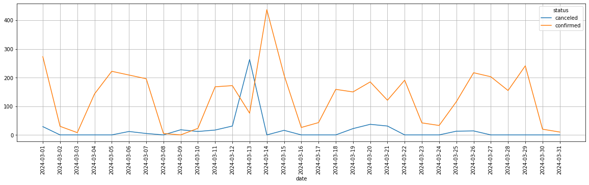
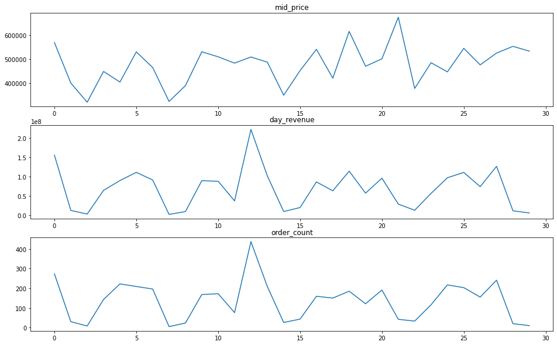

# Анализ оптовых продаж аудиотехники 
(english version below)

## Бизнес-контекст
«Карпов Саунд» — компания, занимающаяся оптовой продажей аудиотехники. Ассортимент включает профессиональные аудиосистемы, домашние кинотеатры, портативные аудиоустройства и аксессуары от ведущих мировых брендов. Компания сотрудничает с крупными розничными сетями и специализированными магазинами аудиотехники в России.

Клиенты оставляют заявки на закупку в CRM-системе, менеджеры связываются с ними, обсуждают детали, после чего заказы либо подтверждаются, либо отменяются. Из-за плановых работ по оптимизации хранилище данных оказалось временно недоступно, поэтому все данные были предоставлены в виде резервной выгрузки, разложенной по разным папкам на сервере компании.

## Цель
Собрать данные из разрозненных источников, проанализировать их и сделать выводы, которые помогут руководству компании принять верные тактические решения.

## Источники данных
- **orders** — данные о заказах (`order_id`, `product_id`, `quantity`), разложены по папкам с датами и именами менеджеров.
- **order_status** — статусы заказов и данные о клиентах (`order_id`, `client_id`, `status`), хранятся рядом с заказами.
- **products** — данные о товарах (`id`, `name`, `price` в долларах), разложены по папкам с категориями товаров.
- **usd_rate.txt** — курс доллара США на каждый день анализируемого периода.

Каждый заказ имеет статус `confirmed` или `canceled`. В одном заказе может быть несколько товаров. Если отменённый заказ был создан заново тем же клиентом с теми же товарами у того же менеджера, в базе остаются две записи с разными номерами и статусами.

## Что сделано
- Собрала и предобработала данные из разрозненных папок и файлов (заказы, статусы заказов, товары, курс доллара).
- Объединила данные в единый аналитический датасет.
- Посчитала ключевые метрики месяца: общую выручку в рублях (с пересчётом по курсу ЦБ на дату заказа) и средний чек.
- Определила день с наибольшим числом заказов и выяснила причину всплеска.
- Проанализировала эффективность брендов и выявила бренды с высокой долей товаров, которые ни разу не заказывали.
- Составила отчёт по менеджерам: доля выручки и доля заказов каждого менеджера.

## Ключевые выводы
- **Выручка за месяц** — 2 038 231 821.56 руб.; **средний чек** — 6 596 219,49 руб.
- **Всплеск продаж объясняется сбоем CRM**: значительная часть заказов, отменённых 13 марта, была оформлена заново 14 марта теми же клиентами у тех же менеджеров. Это не рост спроса, а повторное оформление после сбоя.
- **Лидер по выручке** — бренд **JBL** (266,6 млн руб.), он же лидер по числу заказов (592).
- **Около трети товаров (497 из 1677)** не были заказаны ни разу. У брендов **Dali, KEF, Marantz, Pioneer** доля ни разу не заказанных товаров превышает половину — они занимают «полку» впустую.
- **Лучший менеджер по выручке** — Маргарита Камертонова (17,04%); по числу заказов — Виктор Тромбонов (16,18%). Явной пятёрки лидеров с большим отрывом нет.

## Инструменты
- Python (Pandas, Matplotlib, Seaborn, Os)
- Jupyter Notebook

## Визуализации

*Заказы по дням в разбивке по статусу*


*Динамика выручки, среднего чека и числа заказов по дням*

## Структура проекта
```text
├── data/                                      # Исходные данные
├── wholesale-audio-sales-analysis             # Jupyter Notebook
├── visuals/                                   # Графики
├── README.md
└── requirements.txt
```


# Wholesale Audio Equipment Sales Analysis

## Business Context
Karpov Sound is a wholesale audio equipment company offering a wide range of products from leading global brands — professional audio systems, home theaters, portable audio devices, and accessories. The company works with major retail chains and specialized audio stores across Russia.

Clients submit purchase requests through the CRM system. Managers contact clients, discuss details, and then either confirm or cancel orders. Due to planned maintenance, the company's data warehouse was temporarily unavailable, so all data was provided as a backup export scattered across multiple folders on the company server.

## Objective
Collect data from disparate sources, analyze it, and draw conclusions to help the company's management make sound tactical decisions.

## Data Sources
- **orders** — order details (`order_id`, `product_id`, `quantity`), stored in folders by date and sales manager.
- **order_status** — order statuses and client info (`order_id`, `client_id`, `status`), stored alongside orders.
- **products** — product details (`id`, `name`, `price` in USD), stored in folders by product category.
- **usd_rate.txt** — USD exchange rate for each day of the analyzed period.

Each order has either a `confirmed` or `canceled` status. An order may contain multiple products. If a canceled order was re-created by the same client with the same products and manager, the database keeps both records with different order IDs and statuses.

## What I Did
- Collected and preprocessed data from scattered folders and files (orders, order statuses, products, USD exchange rates).
- Consolidated the data into a single analytical dataset.
- Calculated key monthly metrics: total revenue in RUB (converted at the Central Bank rate on the order date) and average order value.
- Identified the day with the highest number of orders and investigated the cause of the spike.
- Analyzed brand performance and identified brands with a high share of never-ordered products.
- Built a manager performance report showing each manager's share of revenue and orders.

## Key Insights
- **Revenue for the month** — 2,038,231,821.56 RUB; **average order value** — 6,596,219.49 RUB *(уточните: в ноутбуке `middle_price` считается от `total_revenue`, проверьте итоговую цифру после пересчёта в рубли)*.
- **Sales spike explained by a CRM failure**: many orders canceled on March 13 were re-created by the same clients with the same managers on March 14 — this is a repeat of canceled orders, not a demand surge.
- **Top brand by revenue** — **JBL** (266.6M RUB), it is also the leader by number of orders (592).
- **About a third of products (497 out of 1677)** were never ordered. Brands **Dali, KEF, Marantz, Pioneer** have more than half of their products never ordered — they occupy shelf space in vain.
- **Best manager by revenue** — Margarita Kamertonova (17.04%); by number of orders — Viktor Trombonov (16.18%). There is no clear top-5 with a large gap from the rest.

## Tools
- Python (Pandas, Matplotlib, Seaborn, Os)
- Jupyter Notebook

## Visualizations

*Orders by day, split by status*


*Daily revenue, average order value and order count*

## Project Structure
```text
├── data/                                      # Исходные данные
├── wholesale-audio-sales-analysis             # Jupyter Notebook
├── visuals/                                   # Графики
├── README.md
└── requirements.txt
```

